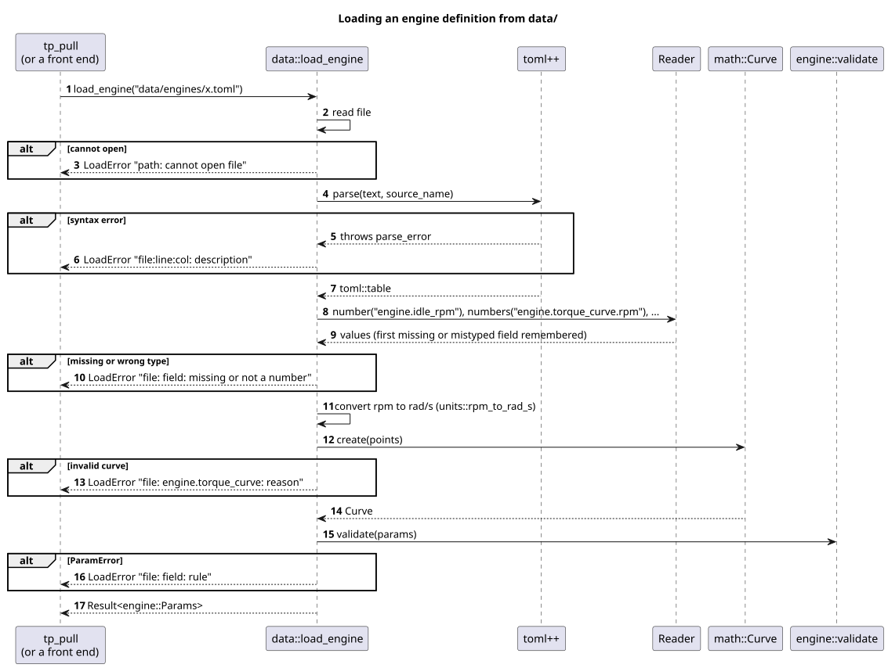

# Architecture

Diagrams of the simulation core and data loading. Sources are PlantUML files
in [`diagrams/`](diagrams/); the rendered SVGs in [`diagrams/svg/`](diagrams/svg/)
are committed so they can be reviewed directly on GitHub. Regenerate them with
`scripts/render_diagrams.sh` (CI fails if an SVG is stale).

## Class diagrams

### Simulation core (`tp::core`)

Pure C++20: no exceptions, no RTTI, no heap allocation in the step. All state
is plain data. Free functions operate on `Params`, `State` and `Input`.

### Data loading (`tp::data`)

Parses TOML from `data/`, converts to SI units and reuses the core's
validation rules. Never used inside the simulation step.

## Sequence diagrams

### One engine step (1 kHz)

### Loading an engine definition

### Frame loop

How a front end drives the fixed-step simulation from a variable frame rate.

